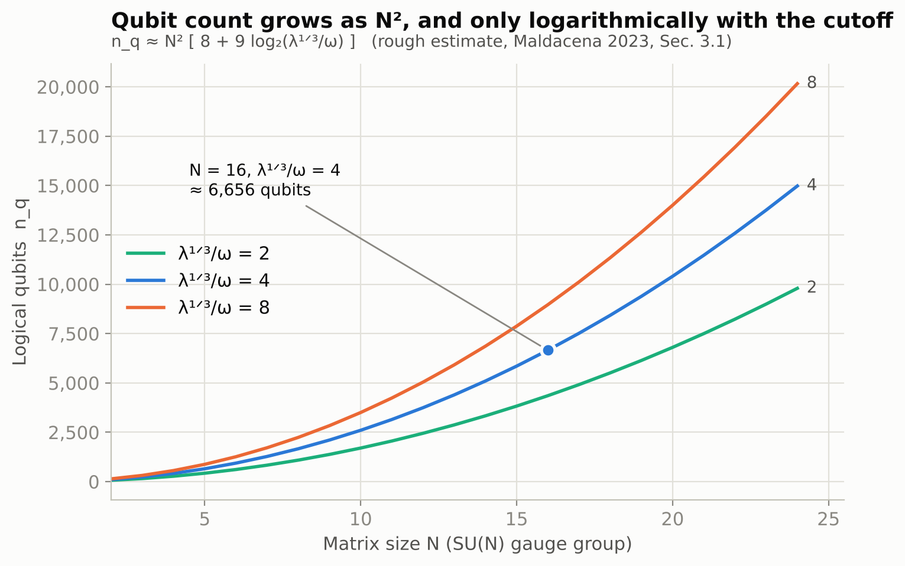
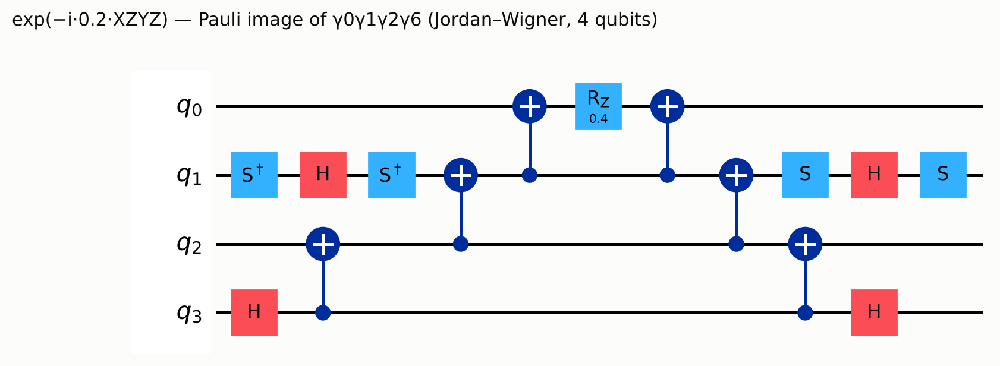
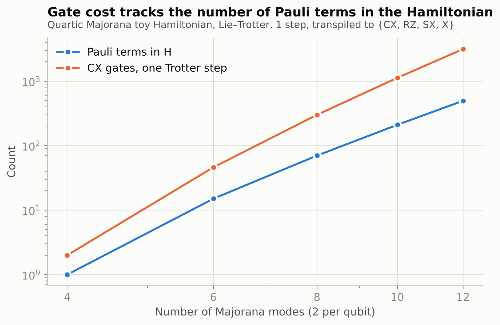
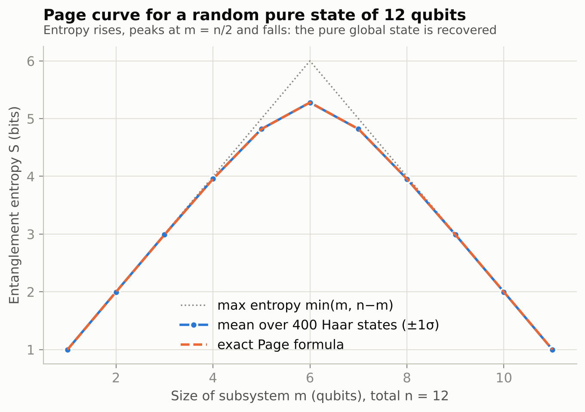
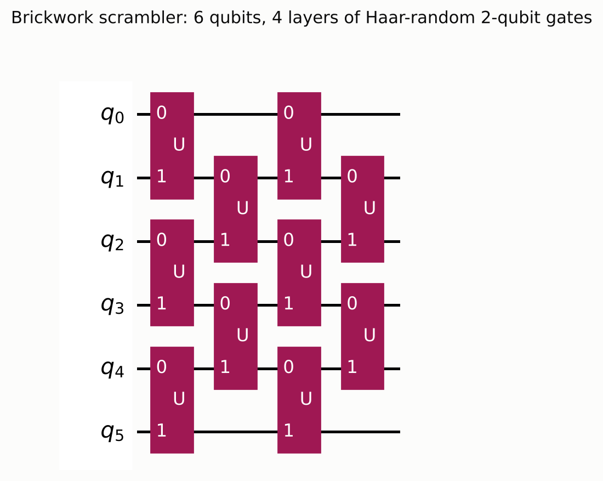
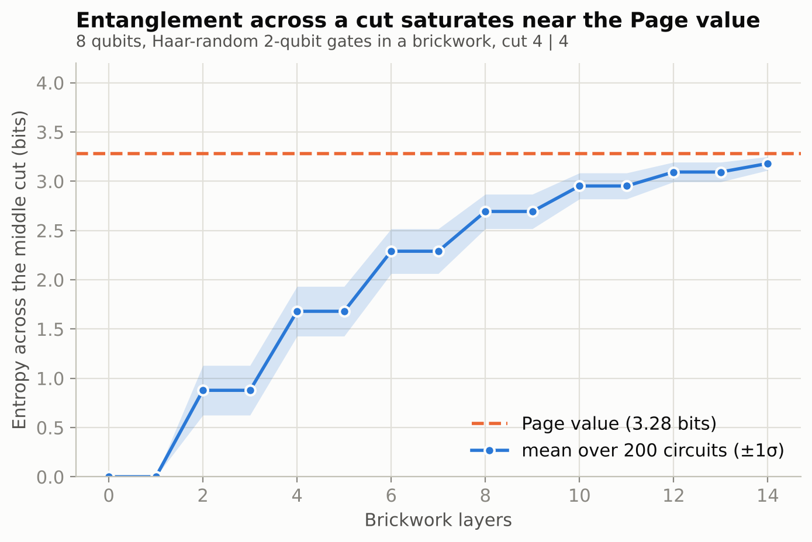
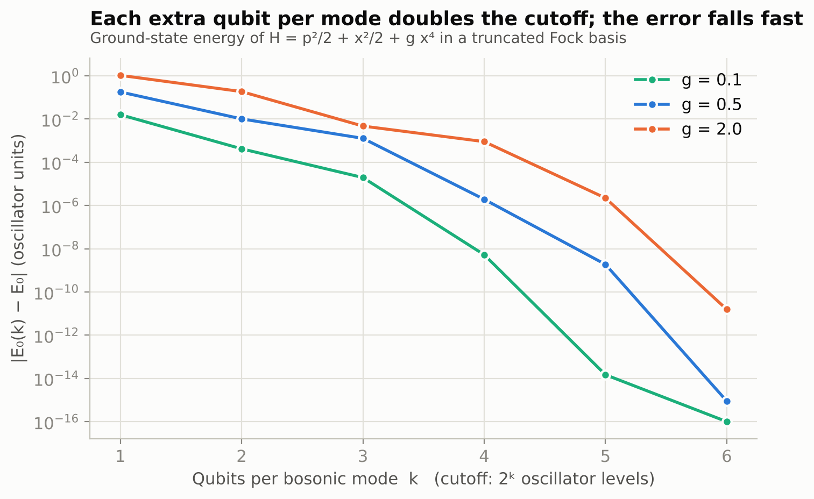

# Toy Experiments on the Cost of Simulating a Holographic Matrix Model


Resource arithmetic and small-scale Qiskit experiments accompanying the article
*"How many qubits does it take to simulate a holographic universe?"*

---

## Abstract

Maldacena (arXiv:2303.11534, Sec. 3.1) gives a rough estimate that simulating the thermal state of a
finite-temperature SU(16) matrix quantum mechanics, a model dual to a black hole, requires about
7,000 logical qubits. This repository reproduces the arithmetic behind that estimate and tests, at
a scale a laptop can handle, the ingredients it rests on: the fermion-to-qubit encoding, the gate cost of
a Trotter step, the Page curve of the information problem, entanglement growth under scrambling
circuits, and the accuracy cost of truncating bosonic modes. Every number reported here is
generated by the code in this repository, with fixed seeds, on Qiskit 2.4.2.

**This is an educational toy project.** It does not simulate the matrix model, does not model noise or
error correction, and makes no claim about our universe. Section 8 states its limits.

## Table of contents

1. [Motivation and scope](#1-motivation-and-scope)
2. [Background and definitions](#2-background-and-definitions)
3. [Repository layout](#3-repository-layout)
4. [Installation and reproduction](#4-installation-and-reproduction)
5. [Experiments](#5-experiments)
6. [Summary of results](#6-summary-of-results)
7. [Reproducibility notes](#7-reproducibility-notes)
8. [Limitations and threats to validity](#8-limitations-and-threats-to-validity)
9. [Possible extensions](#9-possible-extensions)
10. [How to cite](#10-how-to-cite)
11. [License and disclaimer](#11-license-and-disclaimer)
12. [References](#12-references)

---

## 1. Motivation and scope

A resource estimate such as "about 7,000 qubits" carries information only together with its model, its
parameters and its error assumptions. The aim here is to unpack one such estimate in a form that can be
inspected, rerun and criticised.

**In scope**

- Re-deriving the paper's qubit and term counts from its stated formula, with a sensitivity check.
- Verifying that the fermionic encoding behind the count (two Majorana modes per qubit) is correct.
- Measuring how Trotter-step gate cost scales with Hamiltonian term count in a quartic Majorana proxy model.
- Reproducing the Page curve for Haar-random states and the growth of cut entanglement in brickwork circuits.
- Quantifying the error-versus-qubits trade-off of bosonic truncation in an anharmonic oscillator.

**Out of scope**

- Simulating the SU(N) matrix model itself (at N = 16 it needs thousands of logical qubits).
- Noise models, quantum error correction, physical-qubit counts.
- Any statement about whether our universe is holographic. The best-understood examples of the duality
  live in anti-de Sitter space, which is not the observed spacetime.

## 2. Background and definitions

### 2.1 The resource model

The paper's system is SU(N) matrix quantum mechanics with nine Hermitian bosonic matrices
$X^I$ ($I = 1,\dots,9$) and sixteen-component fermions in the adjoint representation, at finite
temperature and strong coupling $\lambda$, plus an $\omega$-deformation. The quantities below are
transcribed from Sec. 3.1 of the paper (see the verification note in [Section 8](#8-limitations-and-threats-to-validity)):

$$
n_q \;\simeq\; N^2\Big[\,8 + 9\log_2\!\big(\lambda^{1/3}/\omega\big)\Big], \qquad
N_{\text{terms}} \;\simeq\; 9^2 N^4 + 16^2\cdot 9\cdot N^3 .
$$

- Fermions: $16N^2$ Majorana modes, two per qubit, cost $8N^2$ qubits.
- Bosons: $9N^2$ real modes (the factor 9 matches nine matrices with $N^2$ real components each; the paper
  does not spell this out, so this is a reading, not a quotation), each truncated at oscillator level
  $\Lambda \equiv \lambda^{1/3}/\omega$ and costing $\log_2\Lambda$ qubits.
- Parameters used by the paper: $N = 16$, $T/\lambda^{1/3} = 0.3$, $\omega/T = 0.8$, giving $\Lambda \approx 4$.
- The paper calls these estimates very rough and does not quantify error-correction overhead.

### 2.2 Entanglement entropy and the Page curve

For a pure state of $n$ qubits split into subsystems of dimension $d_A$ and $d_B$, let $\sigma_i$ be the
singular values of the state reshaped as a $d_B \times d_A$ matrix. The entanglement entropy in bits is

$$
S = -\sum_i p_i \log_2 p_i, \qquad p_i = \sigma_i^2 .
$$

Page's exact Haar average, with $m = \min(d_A, d_B)$ and $n' = \max(d_A, d_B)$, in nats, is

$$
\langle S\rangle = \sum_{k=n'+1}^{m n'} \frac{1}{k} - \frac{m-1}{2n'} \;\approx\; \ln m - \frac{m}{2n'} .
$$

At the symmetric point the shortfall from the maximum is $1/(2\ln 2) \approx 0.7213$ bits.

### 2.3 Fermion encoding

Under the Jordan-Wigner map, with $2n$ Majorana operators on $n$ qubits,

$$
\gamma_{2j} = Z_0 \cdots Z_{j-1} X_j, \qquad
\gamma_{2j+1} = Z_0 \cdots Z_{j-1} Y_j, \qquad
\{\gamma_a, \gamma_b\} = 2\delta_{ab}.
$$

A product of four distinct Majoranas is a single Pauli string, so each quartic term is one Pauli rotation.

### 2.4 Trotterisation

First-order Lie-Trotter with $r$ steps and $H = \sum_j h_j$:

$$
e^{-iHt} \approx \left(\prod_j e^{-i h_j t/r}\right)^r
$$

$$
\left\|e^{-iHt} - \left(\prod_j e^{-i h_j t/r}\right)^r\right\|
\leq \frac{t^2}{2r}\sum_{j<k}\left\|[h_j,h_k]\right\|.
$$

This repository implements one step ($r = 1$) to count gates. The error bound is stated for context and
is not evaluated.

### 2.5 Bosonic truncation

A bosonic mode is represented by its lowest $K = 2^k$ Fock levels on $k$ qubits. With $P_K$ the projector
onto those levels, the truncated Hamiltonian is $H_K = P_K H P_K$, and by the variational principle
$E_0(K) \ge E_0$, converging from above as $K$ grows.

## 3. Repository layout

```text
.
├── README.md                this file
├── requirements.txt         pinned Qiskit, minimum versions for the rest
├── experiments.py           all experiments; regenerates fig/ and results.json
├── article_snippets.py      the code blocks quoted in the article, runnable on their own
├── article.md               the accompanying article (Markdown source)
├── results.json             every reported number, machine-readable
└── fig/
    ├── fig1_resource_estimate.png         qubit count vs N and cutoff
    ├── fig2_page_curve.png                Page curve, 12 qubits, 400 Haar states
    ├── fig3_scrambling.png                cut entropy vs brickwork depth
    ├── fig4a_majorana_term_circuit.png    one quartic Majorana term as a circuit
    ├── fig4b_brickwork_circuit.png        brickwork scrambler, 6 qubits, 4 layers
    ├── fig5_trotter_proxy.png             Pauli terms and CX count vs register size
    └── fig6_boson_truncation.png          truncation error vs qubits per mode
```

## 4. Installation and reproduction

Tested with Python 3.13 on Linux; Qiskit 2.4.2, NumPy 2.5.3, Matplotlib 3.11.2, pylatexenc 2.11.

```bash
git clone https://github.com/<your-username>/<repository-name>.git
cd <repository-name>
python -m venv .venv && source .venv/bin/activate
pip install -r requirements.txt

python experiments.py          # about 8 s in the development environment
python article_snippets.py     # about 5 s
```

`experiments.py` writes `fig/*.png` and `results.json` next to the script. The script asserts at start
that the installed Qiskit is a 2.4.x release, because circuit-synthesis details can differ between minor
versions. `pylatexenc` is required only by Qiskit's Matplotlib circuit drawer.

## 5. Experiments

Each subsection lists the question, the method, and the measured result. All values are taken from
`results.json`.

### A. Resource arithmetic

**Question.** What do the paper's formulas give at $N = 16$, $\Lambda = 4$, and how sensitive is the
result to how the cutoff is counted?

| Quantity | Value |
|---|---|
| Fermion qubits, $8N^2$ | 2,048 |
| Boson qubits, $9N^2\log_2\Lambda$ | 4,608 |
| **Total logical qubits** | **6,656** |
| Boson share of the total | 69% |
| Hamiltonian terms | 14,745,600 |
| Rough gate count (terms $\times \log_2(16N^2) \times \Lambda$, constants set to 1) | $7.1\times10^{8}$ |
| Total if levels $0..\Lambda$ must all be representable, $\lceil\log_2(\Lambda+1)\rceil$ per mode | 8,960 |

The paper quotes a gate count of order $10^8$; the product of the stated factors is $7\times10^8$, which
shows how much the dropped constants matter. The 8,960 figure is a sensitivity check and not a claim
about the paper. One extra qubit per mode costs $9N^2 = 2{,}304$ logical qubits, about 35% of the base total.



### B. Fermion encoding check

**Method.** Build $\gamma_0,\dots,\gamma_7$ on four qubits with `SparsePauliOp`, form all
$\{\gamma_a,\gamma_b\}$ and compare with $2\delta_{ab}\mathbb{1}$.

**Result.** Maximum deviation $0.0$ (exact in floating point). Eight Majoranas fit on four qubits, so $16N^2$ fit
on $8N^2$.

### C. Trotter-step cost in a quartic Majorana proxy

**Method.** For $n = 2,\dots,6$ qubits, build
$H = \sum_{a<b<c<d} J_{abcd}\,\gamma_a\gamma_b\gamma_c\gamma_d$ with $J_{abcd}$ drawn from a standard
normal (the scale does not affect gate counts). Synthesise one Lie-Trotter step with `PauliEvolutionGate`
and `LieTrotter(reps=1)` at $t = 0.1$, then transpile to $\{\text{CX},\text{RZ},\text{SX},\text{X}\}$
(`optimization_level=1`, `seed_transpiler=7`).

| Majoranas | Qubits | Pauli terms | CX gates | CX per term | Depth |
|---|---|---|---|---|---|
| 4 | 2 | 1 | 2 | 2.0 | 3 |
| 6 | 3 | 15 | 46 | 3.1 | 97 |
| 8 | 4 | 70 | 300 | 4.3 | 539 |
| 10 | 5 | 210 | 1,124 | 5.4 | 1,840 |
| 12 | 6 | 495 | 3,134 | 6.3 | 4,826 |

The term count equals $\binom{2n}{4}$ (asserted in the code). CX gates per term grow roughly linearly with
register size because Jordan-Wigner strings lengthen. The paper's $\log_2(16N^2)$ fermion overhead
presumably assumes a logarithmic-weight encoding; no such encoding is implemented here.
A log-log exponent is deliberately not fitted: five points over a factor of three in size cannot support one.

The single term $\gamma_0\gamma_1\gamma_2\gamma_6$ maps to the Pauli string `XZYZ` and compiles to 6 CX, 4 H,
2 S, 2 S$^\dagger$ and 1 RZ.




### D. Page curve for Haar-random states

**Method.** For $n = 12$ qubits, draw 400 Haar-random states (`random_statevector`, seeds 5000 to 5399).
For each $m = 1,\dots,11$ compute the entropy of qubits $0,\dots,m-1$ via singular value decomposition, then the sample mean,
sample standard deviation (ddof = 1) and a normal-approximation 95% confidence interval for the mean,
$1.96\,s/\sqrt{400}$.

**Validation.** The SVD route is compared against `entropy(partial_trace(...), base=2)` on 8-qubit states;
the maximum absolute difference is $1.0\times10^{-14}$ bits.

| $m$ | Mean (bits) | 95% CI half-width | Exact Page (bits) | $z$ |
|---|---|---|---|---|
| 1 | 0.9995 | 0.00004 | 0.9995 | 0.10 |
| 2 | 1.9974 | 0.00009 | 1.9974 | 0.84 |
| 3 | 2.9890 | 0.0002 | 2.9889 | 1.15 |
| 4 | 3.9552 | 0.0004 | 3.9551 | 0.64 |
| 5 | 4.8199 | 0.0007 | 4.8198 | 0.07 |
| 6 | 5.2785 | 0.0011 | 5.2789 | -0.58 |
| 7 | 4.8194 | 0.0007 | 4.8198 | -1.06 |
| 8 | 3.9550 | 0.0004 | 3.9551 | -0.26 |
| 9 | 2.9889 | 0.0002 | 2.9889 | 0.36 |
| 10 | 1.9974 | 0.0001 | 1.9974 | 1.73 |
| 11 | 0.9995 | 0.00005 | 0.9995 | -0.05 |

All 11 means lie within their 95% intervals ($|z| \le 1.73$). The shortfall from maximal entropy at
$m = 6$ is 0.7215 bits against the theoretical $1/(2\ln 2) = 0.7213$. The sample standard deviation at
$m = 6$ is 0.012 bits, so the $\pm1\sigma$ band in the figure is narrower than the plotted line.



### E. Entanglement growth in a brickwork scrambler

**Method.** Start from $|0\rangle^{\otimes 8}$. In layer $L$, apply independent Haar-random two-qubit
unitaries (`random_unitary`) to pairs $(0,1),(2,3),(4,5),(6,7)$ for odd $L$ and $(1,2),(3,4),(5,6)$ for even $L$.
Track the entropy across the cut between qubits 3 and 4 for 14 layers, over 200 circuits
(`numpy.random.default_rng(2611)` supplies the unitary seeds).

Gates in odd layers act inside each half and cannot change cut entanglement, so the curve is a staircase
that rises on even layers only. This is a built-in consistency check, and the data show it.

| Layer | 2 | 4 | 6 | 8 | 10 | 12 | 14 |
|---|---|---|---|---|---|---|---|
| Mean entropy (bits) | 0.878 | 1.680 | 2.290 | 2.693 | 2.952 | 3.094 | 3.180 |
| Std. dev. (bits) | 0.252 | 0.252 | 0.227 | 0.175 | 0.132 | 0.100 | 0.069 |

The Page value for a $4|4$ split is 3.282 bits; after 14 layers the mean reaches 96.9% of it.
Saturation is not complete within the depth studied.




### F. Bosonic truncation

**Method.** For $H = \tfrac12 p^2 + \tfrac12 x^2 + g x^4$, build $a$, $x$ and $p^2$ in a 700-level Fock space,
form $H$, and diagonalise its top-left $K\times K$ block for $K = 2^k$, $k = 1,\dots,6$. The reference
$E_0$ uses $K = 300$; the drift between $K = 200$ and $K = 300$ is at most $1\times10^{-14}$.

| $g$ | $E_0$ | $k=1$ | $k=2$ | $k=3$ | $k=4$ | $k=5$ | $k=6$ |
|---|---|---|---|---|---|---|---|
| 0.1 | 0.5591 | 1.6e-2 | 4.2e-4 | 2.0e-5 | 5.3e-9 | 1.5e-14 | round-off |
| 0.5 | 0.6962 | 1.8e-1 | 1.0e-2 | 1.3e-3 | 1.9e-6 | 1.9e-9 | round-off |
| 2.0 | 0.9516 | 1.0e0 | 1.9e-1 | 4.7e-3 | 9.0e-4 | 2.2e-6 | 1.6e-11 |

Entries show $|E_0(K)-E_0|$. At $k = 2$ (four levels, the reading of $\log_2 4$ in the paper's formula) the
relative error is 0.07%, 1.5% and 20% for $g = 0.1, 0.5, 2.0$. Going from $k = 2$ to $k = 3$ reduces the
$g = 0.5$ error about eightfold. A single anharmonic oscillator is not the matrix model, and the couplings
are arbitrary; only the qualitative trade-off transfers.



## 6. Summary of results

| Claim tested | Outcome |
|---|---|
| Paper's formula at $N=16$, $\Lambda=4$ gives about 7,000 qubits | 6,656; bosons are 69% of it |
| Sensitivity to counting levels $0..\Lambda$ | 8,960 (+35%) |
| Two Majoranas per qubit under Jordan-Wigner | Exact; Clifford algebra holds to machine precision |
| Quartic-term count in the proxy | $\binom{2n}{4}$, asserted |
| Gate cost per term under Jordan-Wigner | Grows from 2.0 to 6.3 CX over 2 to 6 qubits |
| Haar-state entropy vs exact Page formula | 11 of 11 means inside 95% CI |
| Cut entropy after 14 brickwork layers (8 qubits) | 3.18 bits, 96.9% of Page value |
| Truncation error falls rapidly with $k$ | Confirmed in the single-mode toy; error at $k=2$ depends strongly on $g$ |

## 7. Reproducibility notes

- **Seeds.** Page-curve states use seeds 5000 to 5399. Brickwork unitaries and proxy-Hamiltonian couplings
  draw from one `numpy.random.default_rng(2611)` stream, so they depend on the order of draws. Running
  `article_snippets.py`, which draws only the brickwork unitaries, therefore differs from
  `experiments.py` in the second decimal of the scrambling statistics (3.18 ± 0.08 versus 3.18 ± 0.07).
- **Determinism.** Rerunning `experiments.py` on the same software versions regenerates `results.json`
  and the figures. Transpiled gate counts can change with Qiskit versions, which is why the version is asserted.
- **Cost.** Each script runs in seconds on a standard CPU; memory use is dominated by 4096-dimensional
  state vectors and 700 x 700 matrices.
- **Statistics.** Confidence intervals use the normal approximation for the sample mean. Reported standard
  deviations use `ddof=1`.

## 8. Limitations and threats to validity

1. **Provenance of the paper's constants.** The formulas and parameter values in Section 2.1 were
   transcribed from Sec. 3.1 of arXiv:2303.11534 using a machine-assisted reading of the text, and the
   factor-of-9 interpretation is mine. Check them against the paper before relying on them. The paper is
   not redistributed here.
2. **No simulation of the actual model.** Experiments C to F test ingredients on toy systems. None of the
   toys is the matrix model; the proxy Hamiltonian in C is not of the paper's form.
3. **Logical qubits only.** No noise, decoding or error-correction overhead is modelled, and none is
   quantified in the paper either. Physical-qubit counts are a separate question.
4. **Random states are not evaporation.** Haar-random states stand in for a fully scrambled black hole plus
   radiation. The Page curve in D is a property of random states, not a derivation from gravity.
5. **Small sizes.** Eight to twelve qubits for the entropy studies, two to six for the Trotter proxy.
   No asymptotic scaling law is fitted or claimed.
6. **Single-mode truncation.** F examines one oscillator with a quartic potential. Truncation in a coupled
   matrix model, at strong coupling, may behave differently.
7. **Gate-count constants.** The gate figure in A drops all order-one factors and multiplies overheads
   whose combination in the paper is not independently checked.

## 9. Possible extensions

- Implement a logarithmic-weight fermion encoding (Bravyi-Kitaev or a ternary-tree variant) and compare gate
  cost per term against Jordan-Wigner.
- Measure Trotter error against the commutator bound in Section 2.4 on the proxy, and fit $r$ for a target accuracy.
- Exact-diagonalise a heavily truncated small-$N$ bosonic matrix model and study how truncation interacts with the commutator-squared potential.
- Add a stated error-correction model to convert logical counts to physical-qubit estimates, with its
  assumptions explicit.
- Run the brickwork circuits under a noise model to see how noise limits the entanglement reached.
- Test Hayden-Preskill-type recovery of information thrown into a scrambled register.

Issues and pull requests that improve rigour, correct errors or add tests are welcome.

## 10. How to cite

If you use this code or its results, please cite the repository and the paper whose estimate it examines.

```bibtex
@misc{holographic_resource_toy,
  author       = {<Your Name>},
  title        = {Toy Experiments on the Cost of Simulating a Holographic Matrix Model},
  year         = {2026},
  howpublished = {\url{https://github.com/<your-username>/<repository-name>}},
  note         = {Companion code to the article ``How many qubits does it take to simulate a holographic universe?''}
}
```

## 11. License and disclaimer

Choose and add a `LICENSE` file before publishing (MIT or Apache-2.0 are common for research code).

This is an independent educational project. It is not affiliated with the author of the paper, with The
Quantum Insider, or with the producers of the episode that prompted it. Statements about the paper reflect the
author's reading and may contain errors.

## 12. References

1. J. Maldacena, *A simple quantum system that describes a black hole*, arXiv:2303.11534 (2023).
2. J. Maldacena, *The large-N limit of superconformal field theories and supergravity*, Adv. Theor. Math. Phys. 2, 231 (1998), hep-th/9711200.
3. D. N. Page, *Average entropy of a subsystem*, Phys. Rev. Lett. 71, 1291 (1993).
4. D. N. Page, *Information in black hole radiation*, Phys. Rev. Lett. 71, 3743 (1993).
5. S. Ryu and T. Takayanagi, *Holographic derivation of entanglement entropy from AdS/CFT*, Phys. Rev. Lett. 96, 181602 (2006).
6. G. Penington, *Entanglement wedge reconstruction and the information paradox* (2019); A. Almheiri, N. Engelhardt, D. Marolf, H. Maxfield, *The entropy of bulk quantum fields and the entanglement wedge of an evaporating black hole* (2019); A. Almheiri, R. Mahajan, J. Maldacena, Y. Zhao, *The Page curve of Hawking radiation from semiclassical geometry* (2019).
7. K. Moskvitch, *How Many Qubits Would it Take to Simulate a Holographic Universe?*, The Quantum Insider, 2 November 2026.
8. A. M. Childs, Y. Su, M. C. Tran, N. Wiebe, S. Zhu, *Theory of Trotter error with commutator scaling*, Phys. Rev. X 11, 011020 (2021).
