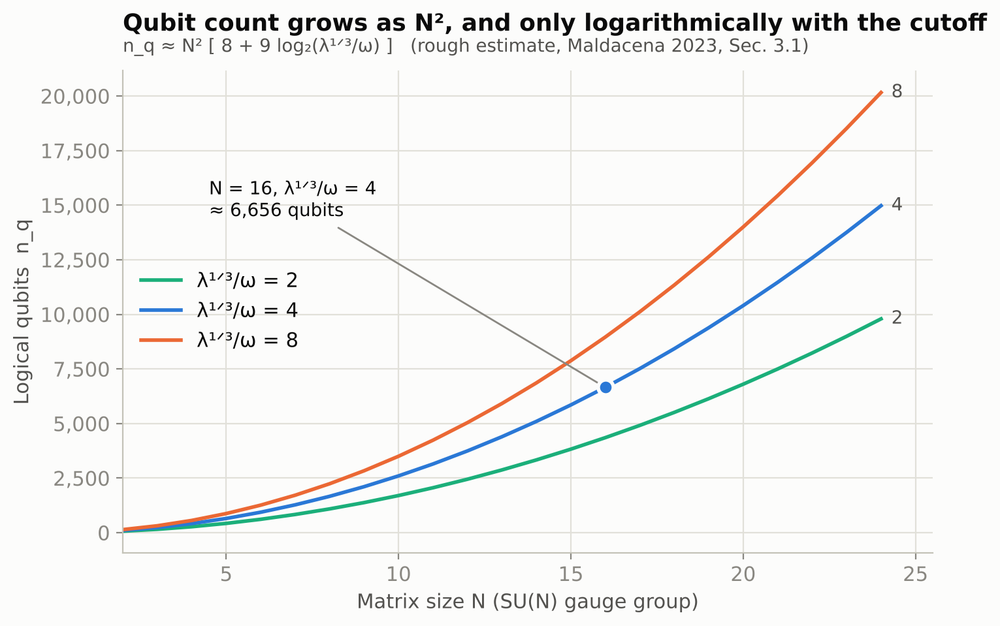
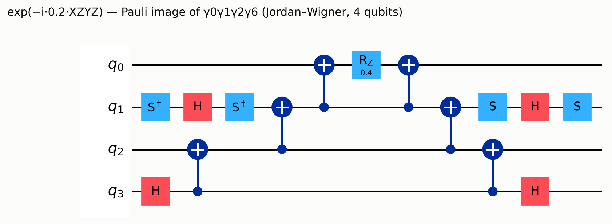
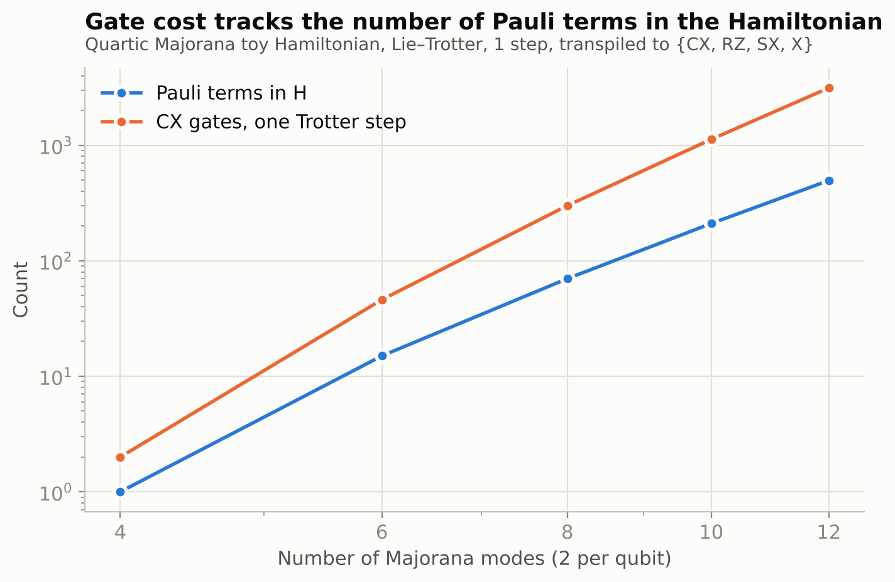
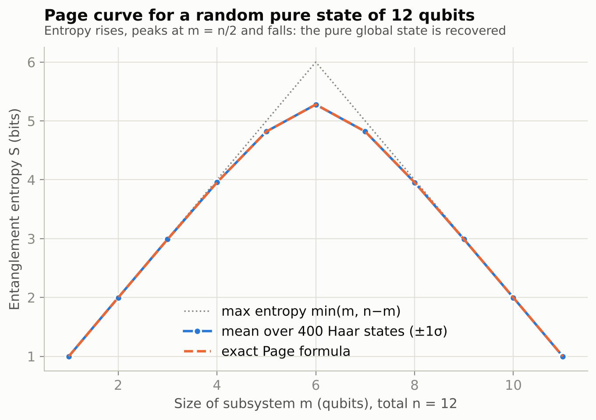
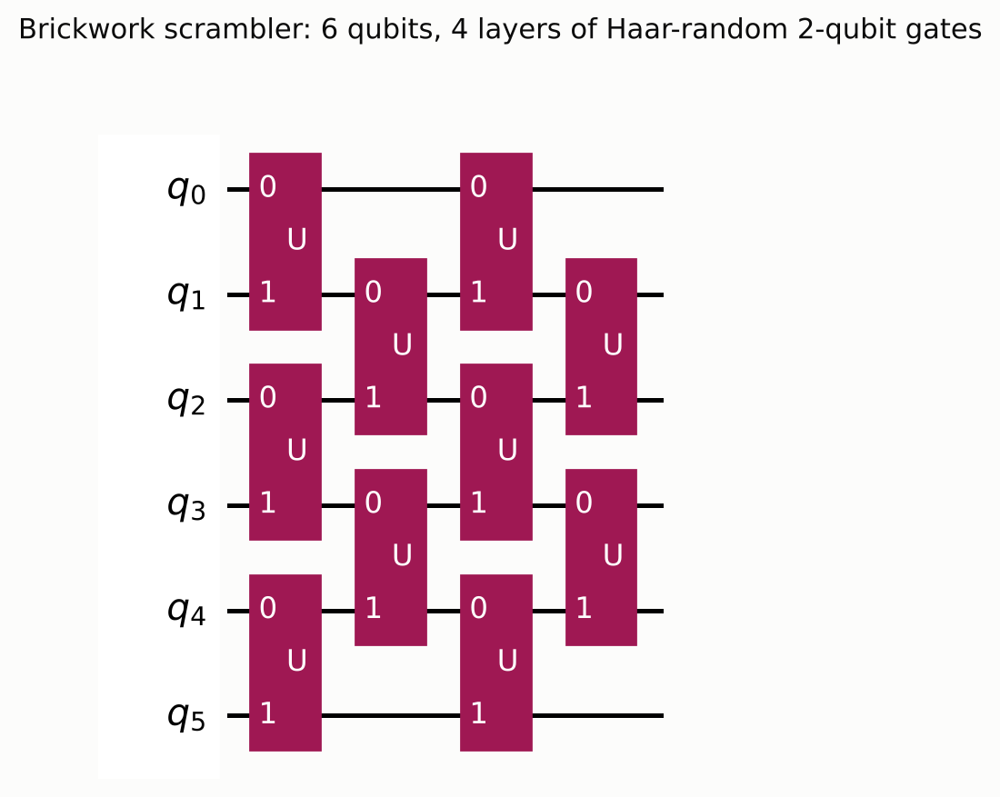
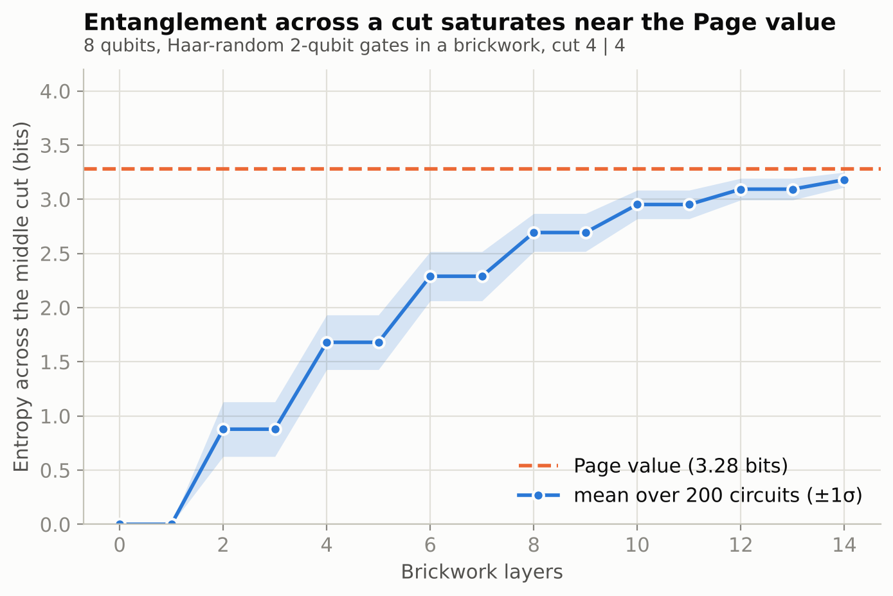
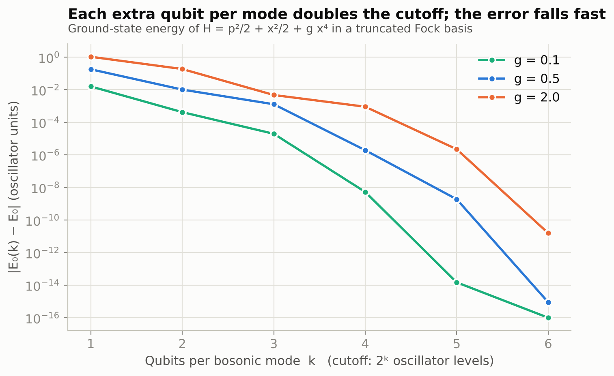

# How many qubits does it take to simulate a holographic universe?

*A look behind the ~7,000-qubit figure, with the arithmetic redone and a few experiments in Qiskit 2.4*

On 2 November The Quantum Insider covered an episode of *The Quantum Kid* in which Juan Maldacena explains the holographic principle and says how many qubits it would take to simulate a holographic universe. The article does not print the number. The episode does: about 7,000 near-perfect qubits.

A figure like that is only useful with its model, its parameters and its error assumptions attached, so I went to the source. It comes from Maldacena's 2023 paper "A simple quantum system that describes a black hole" (arXiv:2303.11534), Section 3.1, where it is offered as a rough estimate. Below I redo the arithmetic, test the pieces that fit in a few lines of Qiskit, and list what the number does not tell you. Everything was run on Qiskit 2.4.2.

## The holographic claim, briefly

Black hole entropy scales with horizon area, not volume, and black holes radiate:

```text
S_BH = k_B c³ A / (4 G ħ) = k_B A / (4 ℓ_P²),      ℓ_P² = G ħ / c³
T_H  = ħ c³ / (8π G M k_B)
```

The second line is the Hawking temperature. It is the reason evaporation, and with it the information problem, cannot be avoided. Holography takes the area law at face value: a gravitational theory in a region is equivalent to a quantum theory without gravity on its boundary. The Ryu–Takayanagi formula makes the link to entanglement explicit (units ħ = c = 1):

```text
S(A) = Area(γ_A) / (4 G_N)
```

Here γ_A is the minimal bulk surface anchored on the boundary region A. This is the sense of the remark in the episode that space may be built out of entanglement. Because the two descriptions are meant to be equivalent, you can compute in whichever one is easier. The boundary side contains no gravity, which makes it the natural target for a quantum computer.

Two caveats. In the episode Maldacena is explicit that it is not known whether our universe is described by these ideas. And the best-understood examples of the duality live in anti–de Sitter space, which is not the spacetime we observe. Nothing below says our universe is a hologram.

## What the 7,000 refers to

The system is SU(N) matrix quantum mechanics: nine Hermitian matrices Xᴵ with their momenta, plus sixteen-component fermions in the adjoint representation. Schematically, with couplings and normalisations left out,

```text
H ∼ Tr[ ½ Pᴵ Pᴵ − ¼ [Xᴵ, Xᴶ]² + ½ ψᵀ γᴵ [Xᴵ, ψ] ] + (ω-deformation),      I, J = 1 … 9
```

at finite temperature and strong coupling λ, where the thermal state is dual to a black hole. The paper's estimate uses N = 16, T/λ¹ᐟ³ = 0.3 and ω/T = 0.8. So the object being simulated is a model of a black hole, not a universe, and that distinction tends to get lost when the number is repeated.

## Redoing the count

The fermions are 16N² Majorana modes. Two Majoranas fit in one qubit, so they cost 8N² qubits. The bosonic Hilbert space is infinite-dimensional and has to be truncated. The paper keeps oscillator levels up to roughly λ¹ᐟ³/ω, which costs log₂(λ¹ᐟ³/ω) qubits per mode. The factor 9 in the formula matches nine matrices with N² real components each; the paper does not spell that out, so take it as my reading. The result:

```text
n_q ≈ N² [ 8 + 9 log₂(λ¹ᐟ³/ω) ]
```

With N = 16 and λ¹ᐟ³/ω ≈ 4 this is 256 × 26 = 6,656, which the paper rounds to about 7,000.

| Piece | Expression | N = 16, λ¹ᐟ³/ω = 4 |
|---|---|---|
| Fermion qubits | 8N² | 2,048 |
| Boson qubits | 9N² · log₂(λ¹ᐟ³/ω) | 4,608 |
| **Total logical qubits** | | **6,656** |
| Hamiltonian terms | 9² N⁴ + 16² · 9 · N³ | 1.47 × 10⁷ |
| Gates, my product of the stated factors | terms × log₂(16N²) × λ¹ᐟ³/ω | 7.1 × 10⁸ |
| Gates, as quoted in the paper | | order 10⁸ |

A few things follow from the table.

The bosons account for 69% of the qubits. The fermions are cheap; the budget goes into truncating the bosonic modes.

The dependence on N is quadratic, so doubling the matrix size quadruples the count. The dependence on the cutoff is logarithmic, but it is multiplied by 9N² = 2,304 modes, so one extra qubit per mode costs 2,304 logical qubits.

The word "about" hides a modelling choice. If levels 0 through 4 must all be representable, each mode needs ⌈log₂ 5⌉ = 3 qubits instead of 2, and the total becomes 8,960, a third larger. I am not saying the paper got this wrong. It calls its own numbers very rough, and this is only a way to see how much slack the rounding carries.

The same applies to gates. Multiplying the stated overheads gives 7 × 10⁸, against the paper's order 10⁸. Constants of order one decide which of those you quote.

Finally, the paper notes an error-correction overhead but does not quantify it. "Near-perfect" in the episode means logical qubits. The physical count is a separate question.



## What I could check in Qiskit

None of the following simulates Maldacena's model; at N = 16 that needs thousands of logical qubits. These experiments test ingredients of the estimate: the fermion encoding, the cost of a Trotter step, the Page curve at the centre of the information problem, scrambling, and boson truncation. The full script, figures and raw numbers are described in the last section.

### Fermions: two Majoranas per qubit

Under the Jordan–Wigner map,

```text
γ_{2j}   = Z₀ Z₁ … Z_{j−1} X_j
γ_{2j+1} = Z₀ Z₁ … Z_{j−1} Y_j          {γ_a, γ_b} = 2 δ_ab
```

```python
import itertools, numpy as np
from qiskit.quantum_info import SparsePauliOp

def majorana(n, k):
    j, r = divmod(k, 2)
    s = ["I"] * n
    for q in range(j):
        s[n - 1 - q] = "Z"                  # Qiskit labels are little-endian
    s[n - 1 - j] = "X" if r == 0 else "Y"
    return SparsePauliOp("".join(s))

n = 4
g = [majorana(n, k) for k in range(2 * n)]
err = max(
    np.abs((g[a].dot(g[b]) + g[b].dot(g[a])).to_matrix()
           - 2 * (a == b) * np.eye(2**n)).max()
    for a, b in itertools.product(range(2 * n), repeat=2)
)
print(f"max |{{γa,γb}} - 2δab| = {err:.1e}")      # 0.0e+00
```

Eight Majoranas on four qubits satisfy the algebra exactly, so 16N² of them do fit in 8N² qubits.

### The cost of one Hamiltonian term

A product of four distinct Majoranas is a single Pauli string, so each quartic term becomes one Pauli rotation. This one, γ₀γ₁γ₂γ₆ on four qubits, is the string XZYZ:

```python
from qiskit import QuantumCircuit, transpile
from qiskit.circuit.library import PauliEvolutionGate

term = QuantumCircuit(4)
term.append(PauliEvolutionGate(SparsePauliOp("XZYZ"), time=0.2), range(4))
tq = transpile(term, basis_gates=["cx", "h", "rz", "s", "sdg"], optimization_level=0)
print(dict(tq.count_ops()))     # {'cx': 6, 'h': 4, 'sdg': 2, 's': 2, 'rz': 1}
```



To see how this adds up I built a proxy: a quartic Majorana Hamiltonian with random Gaussian couplings on n qubits, one first-order Lie–Trotter step, transpiled to {CX, RZ, SX, X}. The proxy is not the paper's model, which is explicitly not of SYK type. It only shows how gate cost follows term count.

| Majoranas | Qubits | Pauli terms | CX gates | CX per term | Depth |
|---|---|---|---|---|---|
| 4 | 2 | 1 | 2 | 2.0 | 3 |
| 6 | 3 | 15 | 46 | 3.1 | 97 |
| 8 | 4 | 70 | 300 | 4.3 | 539 |
| 10 | 5 | 210 | 1,124 | 5.4 | 1,840 |
| 12 | 6 | 495 | 3,134 | 6.3 | 4,826 |

The term count is C(2n, 4), as it should be. CX gates per term grow roughly linearly with register size, because Jordan–Wigner strings get longer. The log₂(16N²) overhead in the paper's gate estimate is what a logarithmic-weight encoding such as Bravyi–Kitaev would give, which I take to be the assumption behind it. I did not check the reference the paper cites for that factor.

One step of first-order Trotter evolution is

```text
e^{−iHt} ≈ ( Π_j e^{−i h_j t / r} )^r,       ‖error‖ ≤ (t² / 2r) Σ_{j<k} ‖[h_j, h_k]‖
```

so the number of steps r needed for a target accuracy multiplies everything in the table. The paper's lower bound on thermal state preparation, about λ¹ᐟ³/T steps, is a floor and not a total.



### The Page curve

The information problem asks what happens to the entropy of Hawking radiation. Hawking's calculation says it grows until the black hole is gone. If evolution is unitary, it must peak around the halfway point and come back down. For a random pure state split into subsystems of dimension m ≤ n, Page's average entropy is

```text
⟨S⟩ = Σ_{k=n+1}^{mn} 1/k − (m − 1)/(2n)  ≈  ln m − m/(2n)          (nats)
```

I sampled 400 Haar-random states on 12 qubits and computed the entropy of the first m qubits for m = 1 … 11:

```python
from qiskit.quantum_info import random_statevector, partial_trace, entropy

def S_bits(sv, m, n):
    """Entropy, in bits, of qubits 0..m-1 of the pure state sv."""
    M = np.asarray(sv.data).reshape(2 ** (n - m), 2 ** m)
    p = np.linalg.svd(M, compute_uv=False) ** 2
    p = p[p > 1e-14]
    return float(-(p * np.log2(p)).sum())

def page_bits(dA, dB):
    m, n = sorted((dA, dB))
    return float((np.sum(1.0 / np.arange(n + 1, m * n + 1)) - (m - 1) / (2 * n))
                 / np.log(2))

n, samples = 12, 400
E = np.empty((samples, n - 1))
for i in range(samples):
    sv = random_statevector(2**n, seed=5000 + i)
    E[i] = [S_bits(sv, m, n) for m in range(1, n)]
mean = E.mean(0)
ci95 = 1.96 * E.std(0, ddof=1) / np.sqrt(samples)

sv8 = random_statevector(2**8, seed=1)       # cross-check against Qiskit's own route
ref = float(entropy(partial_trace(sv8, list(range(3, 8))), base=2))
assert abs(S_bits(sv8, 3, 8) - ref) < 1e-9
```

The SVD route agrees with `partial_trace` plus `entropy` to 10⁻¹⁴ bits; I use it because the density matrix of a 12-qubit state is needlessly large.

| Subsystem m | Sample mean ± 95% CI (bits) | Exact Page (bits) |
|---|---|---|
| 4 | 3.9552 ± 0.0004 | 3.9551 |
| 6 | 5.2785 ± 0.0011 | 5.2789 |
| 8 | 3.9550 ± 0.0004 | 3.9551 |

All 11 sample means fall inside their 95% intervals around the exact value, with the largest deviation at |z| = 1.7. The shortfall from the maximum at m = n/2 is 0.7215 bits against Page's leading correction 1/(2 ln 2) = 0.7213 bits. The standard deviation across states at m = 6 is only 0.012 bits, which is why the ±1σ band in the figure is thinner than the line.

A Haar-random state is a stand-in for a fully scrambled black hole plus its radiation. It does not model evaporation. The 2019 calculations by Penington, by Almheiri, Engelhardt, Marolf and Maxfield, and by Almheiri, Mahajan, Maldacena and Zhao reproduced the turnover from within the gravitational description, with the extra ingredient that geometries of different topology contribute (quantum extremal surfaces, and in later work replica wormholes). That is what the episode means by alternative spacetimes.



### Scrambling

How fast does a circuit of local gates produce Page-like entanglement? Start from |0⟩⊗8 and apply a brickwork of Haar-random two-qubit gates, tracking the entropy across the 4|4 cut:

```python
from qiskit.quantum_info import Statevector, random_unitary
rng = np.random.default_rng(2611)

def brickwork_entropy(nq=8, cut=4, layers=14):
    sv = Statevector.from_label("0" * nq)
    out = [S_bits(sv, cut, nq)]
    for L in range(1, layers + 1):
        for q in range(0 if L % 2 else 1, nq - 1, 2):
            U = random_unitary(4, seed=int(rng.integers(2**31)))
            sv = sv.evolve(U, [q, q + 1])
        out.append(S_bits(sv, cut, nq))
    return out

curves = np.array([brickwork_entropy() for _ in range(200)])
```

After 14 layers the mean entropy over 200 circuits is 3.18 bits with a standard deviation of 0.07, which is 97% of the Page value of 3.28 bits for a 4|4 split. The curve is a staircase, and that is expected: the odd layers act inside each half of the register and cannot change entanglement across the cut. The second decimal moves with the seed.





### Truncating a bosonic mode

The log₂(λ¹ᐟ³/ω) term in the estimate comes from keeping the lowest K = 2ᵏ oscillator levels with k qubits. With P_K the projector onto those levels, H_K = P_K H P_K, and by the variational principle E₀(K) ≥ E₀, approached from above as K grows. A single anharmonic oscillator shows the trade-off:

```python
D = 700
a = np.diag(np.sqrt(np.arange(1, D)), 1)
x = (a + a.T) / np.sqrt(2)
p2 = -((a - a.T) @ (a - a.T)) / 2

def E0(g, levels):                      # H = p²/2 + x²/2 + g x⁴
    H = 0.5 * p2 + 0.5 * x @ x + g * np.linalg.matrix_power(x, 4)
    return np.linalg.eigvalsh(H[:levels, :levels])[0]

for g in (0.1, 0.5, 2.0):
    ref = E0(g, 300)                    # converged: 200 vs 300 levels agree to ~1e-14
    print(g, [f"{abs(E0(g, 2**k) - ref):.1e}" for k in range(1, 7)])
```

| g | E₀ | error, k = 2 | error, k = 3 | error, k = 4 |
|---|---|---|---|---|
| 0.1 | 0.5591 | 4.2 × 10⁻⁴ | 2.0 × 10⁻⁵ | 5.3 × 10⁻⁹ |
| 0.5 | 0.6962 | 1.0 × 10⁻² | 1.3 × 10⁻³ | 1.9 × 10⁻⁶ |
| 2.0 | 0.9516 | 1.9 × 10⁻¹ | 4.7 × 10⁻³ | 9.0 × 10⁻⁴ |

Two qubits per mode is the reading of log₂(4) in the paper's estimate. In this toy, two qubits give a 1.5% error in the ground-state energy at g = 0.5 and 20% at g = 2. Going to three qubits cuts the g = 0.5 error by a factor of about eight, and in the full model it would add 2,304 logical qubits, about 35% of 6,656. The toy oscillator is not the matrix model and these couplings are arbitrary, so the numbers are not transferable. What transfers is the shape: each added qubit per mode is cheap in the exponent of the accuracy, and expensive in absolute qubits because it is paid on every mode.



## What the number does and does not say

**It counts logical qubits.** The episode says as much: what "reliable" means and what accuracy is required are the details that decide everything. Systems with around a thousand qubits exist today, as the episode notes, and those are physical qubits. The Microsoft researcher puts machines close to these specifications two to three years out, which I would read as a vendor's expectation. A logical qubit count of 6,656 with roughly 10⁸ to 10⁹ gates needs an error-corrected architecture, and the paper leaves its overhead open.

**It is a statement about one model.** Finite-temperature SU(16) matrix quantum mechanics in 0+1 dimensions, dual to a black hole, is a long way from a universe, and AdS is not our spacetime. If the simulation were run, it would test a duality, not our cosmology.

**It is still an interesting target.** The paper itself compares the logical qubit count to what is needed to factor integers faster than a classical computer, and the gate count to what breaking RSA would take. I take that as a useful calibration for anyone planning around fault-tolerant hardware: the milestone that would make this simulation feasible would matter well beyond quantum gravity.

## Reproducing this

Python 3.13, Qiskit 2.4.2, NumPy 2.5, Matplotlib 3.11. The full script `experiments.py` regenerates every figure and `results.json`; `article_snippets.py` holds the code blocks above. Seeds are fixed for the Page curve. The scrambling statistics depend on the order in which random numbers are drawn, so a standalone run of the snippet differs from the script in the second decimal.

## References

1. J. Maldacena, *A simple quantum system that describes a black hole*, arXiv:2303.11534 (2023).
2. K. Moskvitch, *How Many Qubits Would it Take to Simulate a Holographic Universe?*, The Quantum Insider, 2 November 2026. Episode of *The Quantum Kid*: https://www.youtube.com/watch?v=tEeKc5Zogd4
3. J. Maldacena, *The large-N limit of superconformal field theories and supergravity*, Adv. Theor. Math. Phys. 2, 231 (1998), hep-th/9711200.
4. D. N. Page, *Average entropy of a subsystem*, Phys. Rev. Lett. 71, 1291 (1993).
5. D. N. Page, *Information in black hole radiation*, Phys. Rev. Lett. 71, 3743 (1993).
6. S. Ryu and T. Takayanagi, *Holographic derivation of entanglement entropy from AdS/CFT*, Phys. Rev. Lett. 96, 181602 (2006).
7. G. Penington, *Entanglement wedge reconstruction and the information paradox* (2019); A. Almheiri, N. Engelhardt, D. Marolf, H. Maxfield, *The entropy of bulk quantum fields and the entanglement wedge of an evaporating black hole* (2019); A. Almheiri, R. Mahajan, J. Maldacena, Y. Zhao, *The Page curve of Hawking radiation from semiclassical geometry* (2019).
